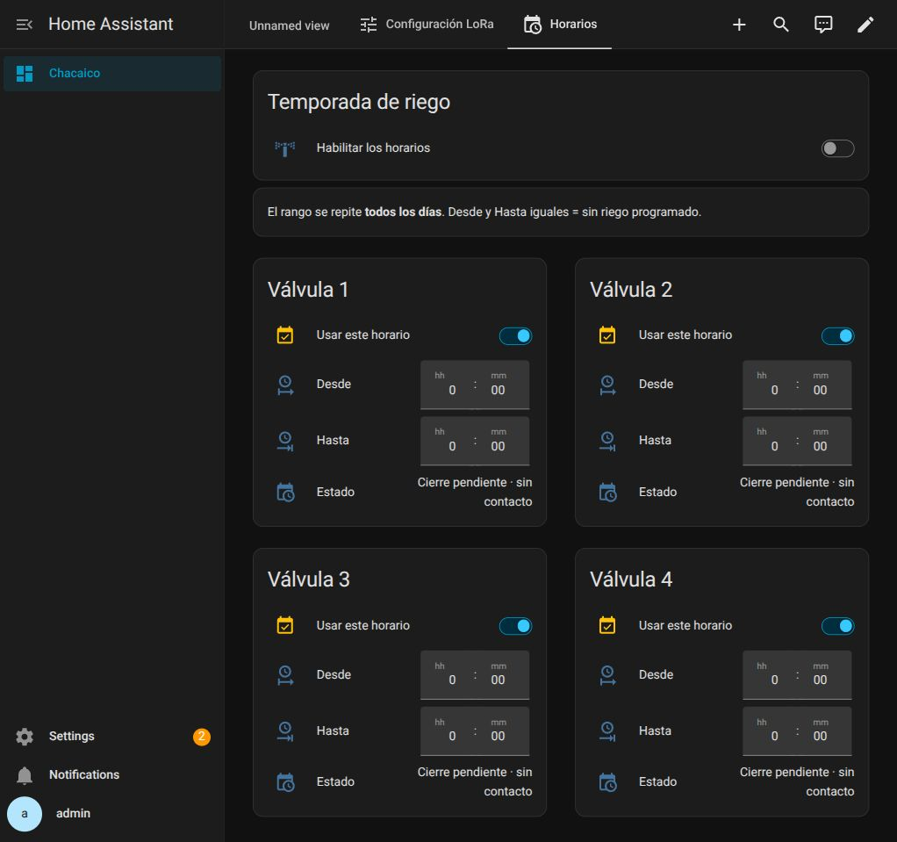
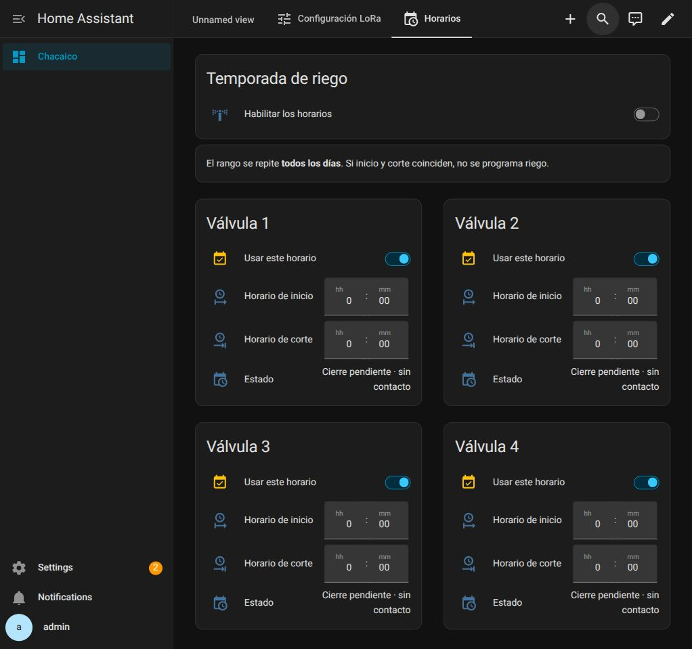

# Rango diario Desde / Hasta — 23/10/2026

A pedido del usuario se reemplazó la grilla semanal por dos campos de hora
editables directamente para cada válvula. Todos los días, con cruce de medianoche;
horas iguales significan sin riego. Se conservan temporada, selector por válvula
y estado confirmado/pendiente. La vista mantiene dos columnas y el perfil admin
se configuró en24h para que las horas y las etiquetas se vean completas.

## Verificado

- 103 pruebas offline: rangos diurnos y nocturnos, inicio/final, horas iguales,
  input no disponible, día local con cambio horario, persistencia, confirmaciones,
  plazos y reintentos anteriores. Ejecutan el YAML y macro Jinja reales.
- `ha core check` y reinicio de Core correctos; ocho entidades input_datetime.
- Editar Desde08:00 / Hasta09:00 del nodo1 desde UI con temporada OFF, leer
  esos valores persistidos en restore_state y restaurar00:00–00:00.
- Todos los rangos finales00:00–00:00; temporada OFF. Las otras tres vistas
  quedaron idénticas a la copia previa.
- No hubo errores de plantilla/controlador en los logs revisados.
- Los cuatro cierres ya estaban pendientes antes de esta actualización. Se
  conservaron sus responsables e intenciones; no se validó accionando válvulas
  ni se cancelaron sus reintentos. Los nodos seguían sin contacto en la UI.

Bridge0.5.1 y firmware sin cambios. Los antiguos Schedule vacíos se conservaron
sin referencia en el controlador diario. Respaldo privado indicado en validation.json;
no contiene el dashboard ni estados privados completos en Git.

Las etiquetas visibles se cambiaron a **Horario de inicio** y **Horario de corte**,
a pedido del usuario. Verificadas completas en las cuatro tarjetas; misma lógica,
entidades y valores.

