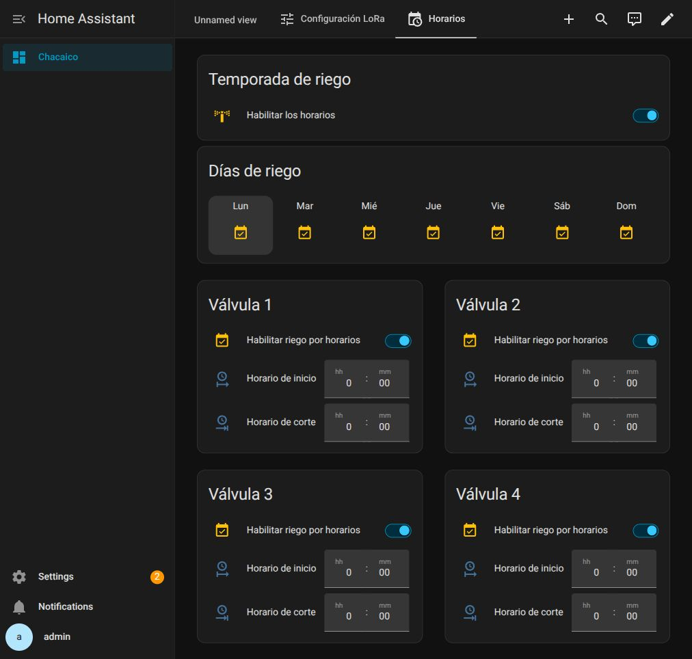

# Días compartidos — 23/10/2026

Se agregó una selección compacta Lun–Dom común a las cuatro válvulas y se retiró
la fila Estado de sus tarjetas. Temporada y días quedan visibles; las tarjetas
de válvula conservan visibilidad dependiente de temporada ON.

- 111 pruebas offline aprobadas. Casos nuevos: cuatro nodos con días comunes,
  día desmarcado/no disponible, ningún día, próxima semana, medianoche y domingo
  a lunes, retirada del día activo y cierre pendiente recuperado tras reinicio.
- `ha core check` aprobado. Helpers, macro, automatización y sensores recargados
  mediante acciones nativas, sin reiniciar Core ni modificar firmware/bridge.
- UI: lunes ON → OFF, persistencia OFF comprobada en restore_state y restaurado
  a ON desde la misma tarjeta. Los siete días finales ON quedaron persistidos.
- Jinja real de HA: cálculo activo con horas ficticias en el editor de plantillas,
  sin modificar helpers de horas; siete dependencias de día reconocidas.
- Temporada ya estaba ON al iniciar esta actualización por acción del usuario;
  se conservó. Ocho horas siguen00:00:00. No se habilitó temporada ni se cambiaron
  horarios para probar. No se enviaron órdenes de válvula como validación física;
  el controlador conserva los reintentos de cierre que ya estaban pendientes.
- Las otras tres vistas se preservaron. Revisión de logs: sin errores nuevos de
  plantillas o controlador en la carga; los avisos MQTT anteriores eran previos.
- La selección corresponde al día de inicio; lunes22:00–01:00 termina el martes.
  Sin días no hay aperturas. Los helpers no tienen `initial` que resetee elecciones.

Backup privado y hashes desplegados en validation.json. Los archivos completos
del dashboard privado no se incluyen en Git.

