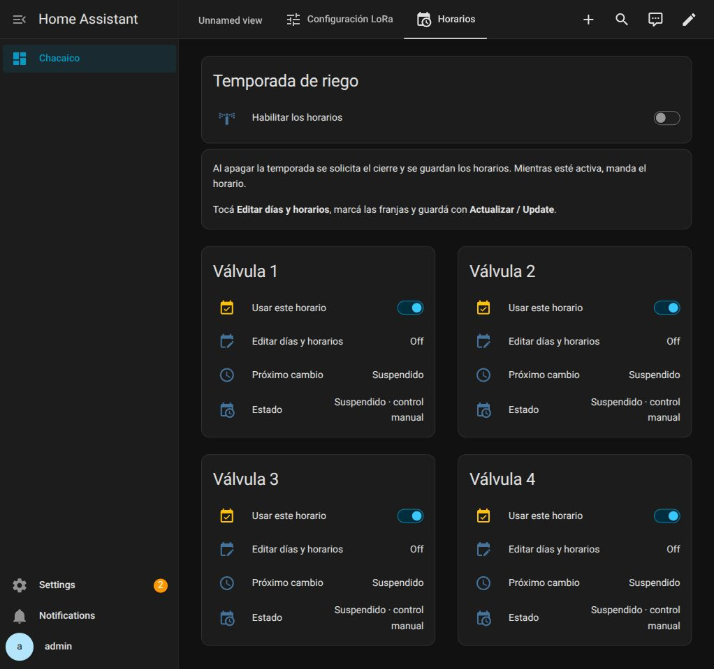

# Horarios — 23/10/2026

Instalados cuatro Schedule nativos editables desde una pestaña nueva. Temporada
manual, selectores por válvula, próximo cambio y estado resumido. Se preservaron
las tres vistas existentes, incluida la principal del usuario. Bridge0.5.1;
firmware de los nodos sin cambios. [Operación](../../../valve-schedules.md).

## Verificado

- 95 pruebas unitarias: paquete YAML real en entorno HA/Jinja modelado y Engine
  real. Incluyen expiración exacta, salto de reloj, confirmación vieja/nueva,
  cierre pendiente tras reinicio y edición sin repetir una apertura confirmada.
- Simulación de arranque: cinco semillas (1,7,42,91,137), ocho nodos modelados,
  pérdida de paquetes y reinicios. No es una prueba de radio física.
- `ha core check`: correcto antes de instalar y con el paquete final.
- Editor nativo: crear lunes08–09, guardar, reabrir y quitar el bloque de prueba
  con temporada y selector apagados. Cuatro helpers verificados vacíos al terminar.
- El acceso Editar abre directamente la configuración nativa del helper.
- Reinicio real de Core: temporada OFF y cuatro selectores ON restaurados;
  propiedad OFF en todos. Se recargó luego la corrección final de automatización.
- Métricas MQTT: cero órdenes desde la actualización del puente; no se accionaron
  válvulas ni LEDs para validar. No hay errores de plantilla/controlador en los
  logs revisados. Hashes públicos de las fuentes desplegadas en validation.json.

La pantalla muestra controles reales después del reinicio. Los estados de
confirmación/expiración se probaron con simulación, sin accionar las válvulas.
Las franjas definitivas y la habilitación de temporada quedan a cargo del usuario.

