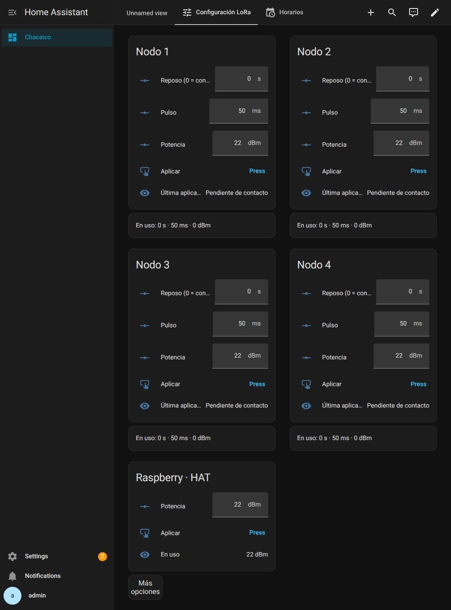

# Potencia máxima —23/10/2026

Solicitud: aplicar la máxima potencia del fabricante al HAT y prepararla para
los cuatro nodos desconectados. No se enviaron órdenes de válvula ni de LED.

## Resultado verificado

- HAT:22dBm solicitado/aplicado; sobrevivió al reinicio del puente durante la actualización.
- Nodos1–4:22dBm solicitado y encolado; estado **Pendiente de contacto**.
- Última configuración conocida de los nodos:0dBm; no se afirma aplicación por radio.
- Se preservaron reposo0s, pulso50ms, escucha3000ms y presupuesto10000ms.
- Runtime persistido: cuatro config_job con22dBm y vencimiento24/10/2026 20:55:27UTC,
  equivalente a17:55:27ART. La cola dura24h y no requiere flasheo al reconectar.
- UI verificada tras reiniciar Core: solicitado22dBm en cuatro tarjetas, pendiente
  de contacto y último valor confirmado0dBm; HAT En uso22dBm.

[Antes](before.json), [después y eventos MQTT](after.json),
[selección pública de persistencia](persisted.json).

## Corrección y despliegue

Puente0.5.1 inicializaba protocolo2 y rechazaba un APPLY avanzado antes del primer
READY después del reinicio, aunque el nodo instalado fuera0.5.0. Puente0.5.2 usa
protocolo desconocido hasta contacto autenticado. Permite encolar y mantiene el
bloqueo para equipos que realmente anuncian v2. El firmware de los nodos sigue0.5.0.
No cambia trama, claves, contador, esquema runtime ni opciones privadas.

- Identidad Pi verificada:2e21da3405714e0cba2d890984d6dfa8.
- Backup privado:/config/chacaico-backups/bridge-v052-20261023T205317Z.
- Backup Supervisor Core+app:721515a3; material privado conservado en la Pi.
- Instalación con Core detenido mediante install-local-app.sh; Core2026.9.4
  reiniciado y bridge0.5.2 en estado started. Opciones e IDs1–4 preservados.
- `python3 -m unittest discover -s tests -q`:114 pruebas, OK.
- `python3 tests/simulate-startup.py`:5 semillas(1,7,42,91,137),8 nodos modelados,
  pérdidas y reinicios; todas las configuraciones confirmadas y cero pulsos de válvula.
- Nuevas pruebas: persistencia antes de contacto→TRIAL/COMMIT v3; protección v2;
  expiración24h. Son simulaciones, no validación RF ni de consumo en campo.

## Fabricantes

- [Waveshare SX1262 LoRaWAN/GNSS HAT](https://www.waveshare.com/wiki/SX1262_XXXM_LoRaWAN/GNSS_HAT):22dBm@3,3V.
- [Ficha SX1261/2 alojada por Waveshare](https://files.waveshare.com/wiki/SX1262-XXXM-LoRaWAN-GNSS-HAT/DS_SX1261-2_V1.2.pdf):SX1262 hasta+22dBm.
- [Heltec HTCC-AB01 original](https://resource.heltec.cn/download/CubeCell/HTCC-AB01/AB01.pdf):22dBm±1dB.

22dBm≈158mW es potencia nominal del transmisor; no se midió RF radiada.
