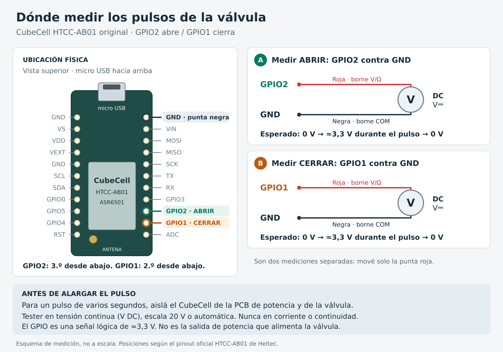

# Configuración remota y ventanas de escucha — firmware y puente 0.5.0

## Operación desde Home Assistant

La pestaña **Configuración LoRa** de Chacaico (`dashboard-chacaico/configuracion-lora`)
contiene una sección por nodo. La vista original de válvulas y LED se conserva.

1. Editar los parámetros solicitados del nodo (tabla siguiente).
2. Pulsar **Aplicar al nodo**. Editar los campos solo modifica el borrador.
3. Esperar **Confirmada** y comprobar los valores, revisión y hora reportados.
4. **Consultar al nodo** pide una lectura nueva; si duerme, espera su anuncio.

| Parámetro del nodo | Rango | Predeterminado |
| --- | --- | --- |
| Reposo | 0–3600 s; 0 mantiene recepción continua | 0 s |
| Pulso GPIO | 10–3000 ms en nodos 1/2 | 50 ms |
| Potencia TX | 0–22 dBm | 0 dBm |
| Escucha renovable | 1000–10000 ms | 3000 ms |
| Presupuesto despierto | 5000–60000 ms | 10000 ms |

El presupuesto debe ser al menos escucha +1000 ms y pulso +2000 ms. Aumentarlo
primero si se necesita una escucha más larga. Una combinación inválida conserva
el borrador anterior y muestra el motivo. Aplicar manda los cinco parámetros
juntos, con una revisión. Consultar devuelve la configuración guardada realmente.

La potencia del HAT tiene su propio borrador y botón **Aplicar potencia**. Se
aplica localmente en el puente, persiste al reiniciarlo y no modifica la del nodo.
14 dBm ≈25 mW; 20 dBm =100 mW; 22 dBm ≈158 mW. Son ajustes nominales del chip,
no mediciones de potencia radiada ni garantías de alcance.

Por nodo, **Aplicar política** guarda en el puente dos valores independientes:

- Vigencia de órdenes: 0–7200 s; 0 calcula un plazo automático. Solo afecta
  órdenes nuevas de válvula/LED. Cambiarlo no prolonga las que ya están pendientes.
- Contactos perdidos tolerados: 1–20, predeterminado 3. Modifica cuándo se declara
  Sin contacto; no cambia el reposo del nodo ni la vigencia de una orden.

La vista principal muestra **Orden de válvula** debajo de cada control: Pendiente,
Confirmada, Sin confirmación; consultando, o Vencida sin confirmar. Es exclusiva
de esa válvula y las órdenes de LED no la sobrescriben. Tras reiniciar el puente
empieza en Sin órdenes pendientes. Los parámetros siguen en Configuración LoRa.

Los valores confirmados son los que devolvió el nodo, no una copia optimista de
lo solicitado. Permanecen visibles durante el reposo. La hora permite distinguir
una lectura reciente de otra anterior. Un error de escritura permanece visible
hasta Aplicar o Consultar; una consulta posterior confirma la configuración que
sigue vigente, no que el intento fallido se haya aplicado.

El reposo predeterminado es **0 s**, escucha continua. El pulso predeterminado es
**50 ms**. El límite configurable es 10–3000 ms en ambos nodos; ambos quedaron aplicados a50 ms.
Son restricciones del software, no una validación
eléctrica de cualquier electroválvula. El pulso no representa duración del riego.
No hay cierre autónomo ni sensor de posición: una confirmación de válvula solo
certifica la ejecución del GPIO. El LED independiente consume energía si se deja
encendido, también durante el reposo.

## Medir los GPIO con un tester

En el HTCC-AB01 original, mirando los componentes con el micro USB hacia arriba,
GPIO2 es el tercer contacto desde abajo de la hilera derecha y GPIO1 el segundo.
El contacto superior de esa hilera es GND. Son nombres de GPIO, no números de
patillas del chip. Posiciones verificadas en el
[pinout oficial de Heltec](https://resource.heltec.cn/download/CubeCell/HTCC-AB01/HTCC-AB01_PinoutDiagram.pdf);
el [esquemático oficial](https://resource.heltec.cn/download/CubeCell/HTCC-AB01/HTCC-AB01_SchematicDiagram.pdf)
identifica las mismas señales. No confundir la placa original con la V2 de USB-C.

Usar tensión continua, escala 20 V o automática: punta negra en COM/GND y roja en
el borne V/Ω y el GPIO que se prueba. GPIO2 sube a aproximadamente 3,3 V al abrir;
GPIO1 al cerrar. El otro GPIO queda en 0 V y ambos vuelven a0V al terminar el pulso.
No medir en modo corriente ni continuidad. Esto comprueba la señal lógica del
CubeCell; la tensión en la salida de potencia depende de la PCB externa.

El pulso predeterminado de 50 ms y aun 200 ms pueden ser muy breves para un tester
común. El20/10/2026 se habilitó y aplicó **3000 ms al nodo1**, con autorización del
usuario para probarlo separado de PCB/válvula. Firmware0.4.1 y bridge0.4.2 conservan
la confirmación después de completar el pulso, deduplicación y retorno a LOW.
Posteriormente, el usuario pidió ampliar también el máximo del nodo2 a3000 ms
y restaurar50 ms en ambos. Se programó nodo2 con firmware0.4.1 y se desplegó
bridge0.4.3. Ambos confirmaron50 ms; el reposo se conservó en0 s.
La ampliación del límite no cambia por sí sola el pulso aplicado.
Evidencia: [ampliación y restauración](evidence/2026-10-20/both-pulse-limit/README.md).

**Antes de reconectar la potencia, aplicar50 ms y comprobar el valor confirmado.**
El parámetro se conserva al reiniciar; no vuelve automáticamente a50 ms. Restaurar
el pulso también antes de bajar a versiones que rechazan valores superiores a200 ms.
Para esa prueba, aislar el CubeCell de la PCB de potencia y de la válvula: no se
ha comprobado que admitan excitación prolongada. Si se mide con la electrónica
conectada, conservar sus tiempos admitidos y usar osciloscopio o analizador lógico
compatible con 3,3 V. Alternar abrir/cerrar para repetir la medición: pedir el estado
ya confirmado no vuelve a generar un pulso.

## Ventana de comunicación

Con reposo positivo el nodo despierta, anuncia READY y escucha inicialmente
**3 segundos por defecto**, según Escucha renovable. Cada intercambio válido
renueva la espera, con un presupuesto de **10 segundos por defecto** desde el
anuncio, configurable como Presupuesto despierto. El puente responde cuando recibe el
anuncio, entrega órdenes pendientes y cierra con END. Si no hay respuesta, el
nodo vuelve a dormir solo. Pulso, ACK y destellos ya iniciados terminan antes de
dormir; por eso el límite es un presupuesto y no un corte eléctrico abrupto.
Hay un pequeño jitter de anuncio/reposo para reducir colisiones entre nodos.

La radio usa 150 ms de margen antes de responder; el puente reserva tiempo de RX
para no tapar ese ACK. El scheduler puede atender otro nodo mientras espera un
reintento. Prioriza cierre solicitado y órdenes del usuario sobre consultas de
fondo. No garantiza entrega si no hay enlace.

El estado **Reposo esperado** no equivale a desconexión. Se declara Sin contacto
si no llega un ACK autenticado durante `tolerancia × período +10` segundos. Con
reposo positivo, período = reposo + presupuesto despierto/1000 +0,25 s; con
recepción continua se usan 32 s por los anuncios periódicos con jitter.

Vigencia automática = `max(15, reposo + presupuesto despierto/1000 +10)` segundos.
Si hay configuración pendiente, se toman conservadoramente los mayores valores
actuales/solicitados. Una vigencia explícita puede vencer antes del próximo
despertar: se informa **Vencida sin confirmar** y se deja de transmitir esa orden.
Un ACK que llega después del vencimiento no cambia esa orden a Confirmada.
Si hubo transmisión antes de vencer, no es posible asegurar que el GPIO no actuó;
la consulta siguiente recupera el estado sin reenviar la intención vencida.

La configuración tiene un plazo independiente de24 horas y se conserva al
reiniciar el puente. Las órdenes de válvula/LED no se guardan para reproducirse
tras un reinicio. No hay cierre autónomo.

## Potencia del nodo: prueba antes de guardar

Un SET_CONFIG con potencia distinta inicia una prueba de8 segundos en RAM.
El nodo responde con la potencia nueva y estado TRIAL; todavía no la guarda.
Solo cuando el puente recibe esa respuesta envía COMMIT_CONFIG. El nodo guarda
los cinco parámetros juntos y devuelve su confirmación estable. Si no recibe
COMMIT_CONFIG a tiempo, vuelve a la potencia/configuración anterior sin escribir
flash. Durante esa prueba queda despierto aunque supere el presupuesto normal.

Si se pierde el ACK final, el puente consulta para averiguar lo que quedó guardado.
Un reinicio durante la prueba descarta los cambios todavía no guardados. Un fallo
de escritura conserva la configuración anterior y se informa como error. Esto
reduce el riesgo de perder un nodo al bajar demasiado la potencia; no garantiza
que el enlace continúe funcionando ante cambios posteriores del entorno.

## Métricas en Configuración LoRa

- RSSI/SNR nodo→HAT y HAT→nodo: la segunda medición la reporta el propio CubeCell.
  Corresponden al último intercambio autenticado, no a un promedio ni un margen
  de enlace. Sin medición disponible se muestra desconocido.
- Órdenes de válvula/LED aceptadas, confirmadas, vencidas, sustituidas y pendientes.
  El porcentaje de éxito usa confirmadas/(confirmadas+vencidas); excluye pendientes
  y sustituidas. No es una tasa de pérdida de paquetes.
- Intentos TX, errores locales de transmisión, reenvíos de una transacción y
  respuestas válidas: también cuentan consultas, configuración y END.
- Última orden finalizada: envíos, espera hasta el primer envío, demora desde
  primer envío y demora total. Si nunca se transmitió, demora desde envío queda
  desconocida y la espera es toda su permanencia en cola. Una reconciliación puede
  confirmar un estado ya alcanzado sin nuevos envíos de esa orden.
- Tiempo de última respuesta: desde finalizar TX hasta recibir ACK, incluido
  el pulso GPIO cuando corresponde; con reintentos no identifica a cuál copia
  respondió el nodo. No confundirlo con la demora total desde el clic.

Los contadores son por sesión del puente y se reinician al arrancarlo. Se muestra
**Contadores desde**. El histórico de Home Assistant depende de su recorder.

## Protocolo, persistencia y recuperación

Protocolo v3: 47 bytes, AES-CMAC truncado a64 bits con clave individual. Incluye
ID, sesión persistente de arranque, despertar, secuencia, operación, resultado,
revisión, cinco parámetros, estados LED/válvula, señal recibida y bandera de prueba.
El bridge0.5.0 también habla v2 (38 bytes) con nodos0.4.x durante la actualización,
pero rechaza aplicarles los nuevos parámetros. El firmware0.5.0 habla solo v3:
actualizar primero el puente. Sin compatibilidad con0.3.0.
Frecuencia916,8MHz, SF7, BW125kHz y CR4/5 se mantienen.47 bytes ocupan nominalmente
92,416 ms de aire con el perfil actual. No se cambia el bootloader ni se implementa OTA.

SET_CONFIG es independiente de SET_VALVE y SET_LED. Se aplican los cinco parámetros
juntos, con revisión y lectura de verificación. Todos los ACK devuelven la
configuración completa. Si se pierde un ACK, una consulta permite reconciliar lo
que realmente quedó aplicado. Reintentos de una misma transacción no repiten
pulsos ni escrituras. Una nueva orden de válvula al mismo estado conocido tampoco
repite el pulso. Tras reiniciar el nodo la posición vuelve a desconocida.

Tres filas separadas de user flash del ASR6501 contienen registros con CRC y
contador de generación; se escribe una fila inactiva y se verifica leyéndola.
El esquema2 de40 bytes migra los registros anteriores de32 bytes conservando
ID, contador de arranque, revisión, reposo y pulso. Potencia/ventanas nuevas toman
los valores predeterminados. Después de la migración no instalar firmware antiguo
que desconozca este registro: podría recuperar datos y contadores obsoletos.
La recuperación debe hacerse con firmware compatible y las claves/estado vigentes.
La fila 3 del fabricante no se toca. Un fallo de persistencia del contador de
arranque impide aceptar órdenes. Hay una escritura por arranque y por cambio de
configuración, no por despertar. Es flash con desgaste finito; no usar Aplicar
como temporizador ni reiniciar continuamente para controlar un nodo.

El puente guarda borradores, confirmaciones y configuración pendiente con rename
atómico y fsync. Reserva secuencias en bloques para reducir escrituras en la SD.
Preservar su directorio de datos y las claves en actualizaciones/restauraciones.
Un archivo persistente inválido detiene el puente antes de reutilizar secuencias.

## Instalación y validación

Compilar cada ID y verificar su manifiesto antes de cargar por su puerto físico.
No intercambiar las dos placas ni usar el serial CP2102 común para identificarlas.
Respaldar el add-on y Home Assistant antes de actualizar; la copia de HA necesita
Core disponible. Para construir el add-on en la Pi de 1 GB, detener Core después
del respaldo y reactivarlo al terminar.

`home-assistant/scripts/node-config-view.py` genera la vista y puede combinarla
con una copia privada del dashboard de almacenamiento. Conserva las otras vistas.
`deploy-config-view.sh` recibe directorio remoto de app, JSON combinado y SHA256
del dashboard original; comprueba identidad de Pi, respaldo y ausencia de edición
concurrente antes de sustituir el archivo con Core detenido. No publicar `.storage`.

Las pruebas offline incluyen pérdidas, reinicios, ocho nodos, cortes de escritura,
autenticación, tiempo GPIO y retorno a recepción. No prueban consumo eléctrico,
alcance en el campo, desgaste a largo plazo ni posición física de la válvula.
Las pruebas de banco deben usar consultas/configuración/LED. La primera actuación
física de válvula corresponde al usuario desde Home Assistant.
